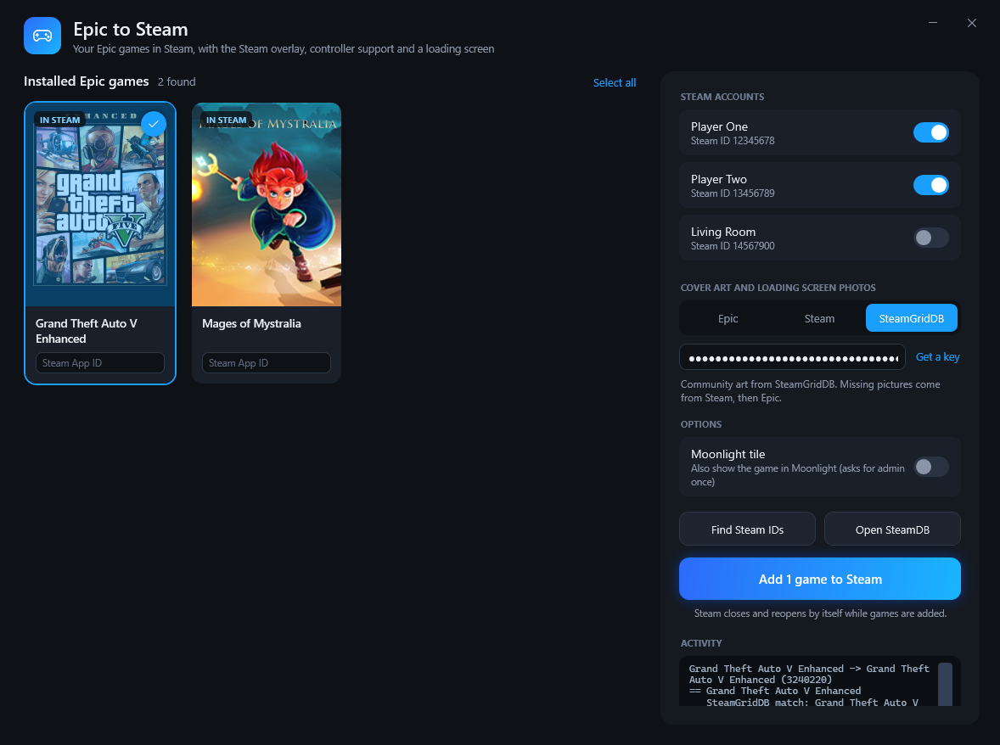
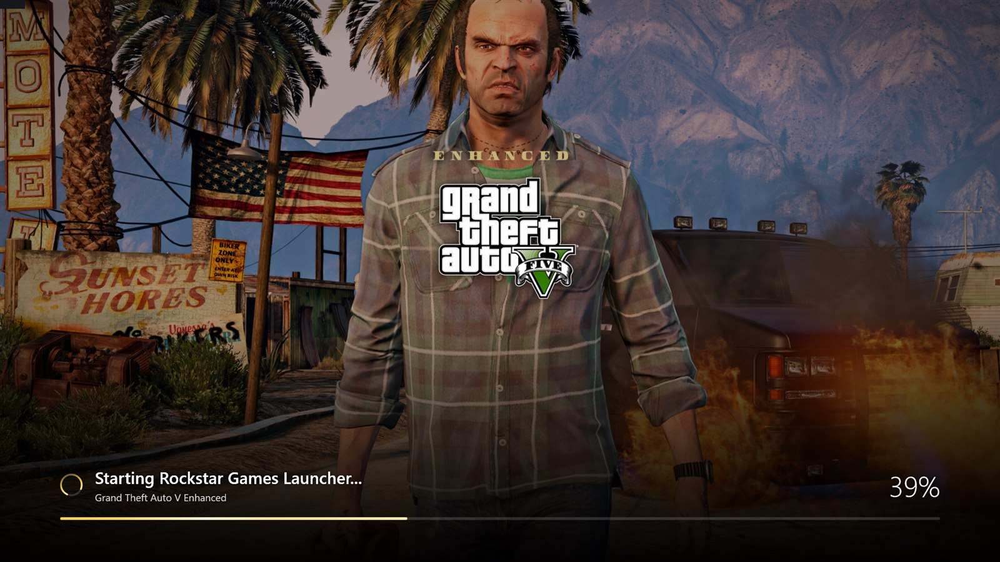

<p align="center">
  
</p>

<h1 align="center">Epic to Steam</h1>

<p align="center">
  <b>Play your Epic Games Store games from Steam, with the real Steam overlay, Steam Input and a console-style loading screen.</b><br>
  Made for Steam Big Picture, couch gaming and streaming with Sunshine / Moonlight.
</p>

<p align="center">
  <a href="../../releases/latest"><b>Download the latest release</b></a> ·
  <a href="#how-to-use">How to use</a> ·
  <a href="#how-it-works">How it works</a> ·
  <a href="#faq--troubleshooting">FAQ</a>
</p>

<p align="center">
  
</p>

---

## Why

You can add an Epic game to Steam as a "non-Steam game", but it doesn't work well:

- The **Steam overlay doesn't appear**, because the game is started by the Epic launcher, outside Steam.
- **Steam shows the game as stopped** right away, so Big Picture comes back while you're still playing.
- Launchers like **Rockstar Games Launcher** pop up over everything, and may even ask for admin rights every time.
- There's **no cover art** and nothing to look at while the game loads.

Tools like GlosSI work around this with injected windows and device hiding, which can be fragile. **Epic to Steam** fixes the launch chain itself instead: no injection, no virtual controllers, no hidden devices.

## Features

- 🎮 **Real Steam overlay and Steam Input** in Epic games (Shift+Tab, the guide button, controller configs, screenshots).
- ▶️ **Steam shows "Playing"** for as long as the game runs, then brings you back to Big Picture when it ends.
- 🖼️ **Loading screen** while the game starts. It shows a slideshow of the game with a slow zoom, the game's logo, what's happening right now ("Starting Rockstar Games Launcher…"), and a progress bar that learns how long each game takes.
- 🙈 **Launcher windows are hidden** while the game loads (Epic, Rockstar…). They come back automatically if one needs you, for example to sign in.
- 🖌️ **Cover art** from Epic, the Steam store or [SteamGridDB](https://www.steamgriddb.com): portrait, wide, hero and logo.
- 👥 **Several Steam accounts** at once, handy when the whole family plays on one PC.
- 📺 **Sunshine / Moonlight tiles**, optional: each game can also appear as its own tile in Moonlight.
- 🛡️ **No admin popups for Rockstar games.** The Rockstar Games Launcher is told to skip its installer check, which otherwise asks for admin on every launch.
- 🧹 **Nothing is installed.** It's a folder with two small programs and a script. Delete the folder to remove it.

<p align="center">
  
  <br><sub>The loading screen while GTA V Enhanced starts</sub>
</p>

## Requirements

- Windows 10 or 11
- [Steam](https://store.steampowered.com/about/)
- The **Epic Games Launcher** with your games installed (the current launcher)
- Optional: a free [SteamGridDB API key](https://www.steamgriddb.com/profile/preferences/api) for community artwork
- Optional: [Sunshine](https://github.com/LizardByte/Sunshine) for Moonlight tiles

No .NET, Python or other runtimes are needed. Everything uses what Windows already has.

## Install

1. Download **`EpicToSteam-vX.Y.Z.zip`** from the [latest release](../../releases/latest).
2. Unzip it into a **permanent folder**, for example `C:\Games\EpicToSteam`. Steam's shortcuts will point to this folder, so don't leave it in Downloads.
   > Avoid folders under `AppData`.
3. Double-click **`EpicToSteam.exe`**.

   Windows SmartScreen may warn you because the programs aren't code-signed. Click **More info → Run anyway**, or build them yourself from source (see [Build from source](#build-from-source)).

## How to use

1. **Pick games.** Every installed Epic game shows as a card. Click the ones you want. **IN STEAM** means a game was already added; adding it again just updates it.
2. **Pick Steam accounts.** Accounts that already have non-Steam games are switched on.
3. **Pick where the art comes from:**
   - **Epic:** always available.
   - **Steam:** official store art. Click **Find Steam IDs** first, check any match marked "check this one", or look the game up with **Open SteamDB**.
   - **SteamGridDB:** community art. Paste your API key once; it's remembered.

   Missing pictures are filled in from the next source. The same sources also supply the loading-screen photos.
4. Optional: turn on **Moonlight tile**. Windows asks for admin permission once to update Sunshine.
5. Click **Add to Steam**. Steam closes, the shortcuts are written (a backup is kept), and Steam opens again.

Your games are now in Steam's library. Run the app again whenever you install a new Epic game.

## How it works

Steam only puts its overlay into programs it starts itself, and into everything those programs start. Normally an Epic game is started by the Epic launcher that's already running, so it's outside Steam's "process tree".

Each Steam shortcut runs `EpicSteamLauncher.exe`, which rebuilds that chain:

```
Steam ─► EpicSteamLauncher ─► Epic Games Launcher (started fresh) ─► publisher launcher ─► game
                 │
                 └─ shows the loading screen, hides launcher windows, waits for the game
```

1. It closes a running Epic launcher, plus any publisher launchers given with `--kill-path`.
2. It starts Epic itself with the game's launch link, so everything after it inherits Steam's overlay. Steam's "this is a Steam game" environment variables are removed (except `SteamOverlayGameId`); otherwise launchers like Rockstar's think it's the Steam edition and fail.
3. It shows the loading screen until the game's window appears.
4. It stays running while you play, so Steam shows *Playing*. Afterwards it closes Epic and leftover launchers and returns to Big Picture.

Everything is logged to `log.txt` next to the program, including which processes got the Steam overlay.

## FAQ / troubleshooting

**Will this get me banned?**
The Steam overlay is loaded the same way it is for any non-Steam game, and anti-cheat systems like BattlEye and EAC normally accept it. Nothing is injected by this tool itself. Online games' rules are still up to each game.

**Starting a game closes the Epic launcher. Why?**
Epic has to be started *by Steam's chain* for the overlay to work. If Epic is downloading something at that moment, the download pauses and resumes the next time Epic opens.

**A Rockstar game asked for admin rights / showed "Failed to launch Steam".**
Run the app again for that game. It adds `-skipInstallers` to the game's Epic launch options and removes Steam's markers for the Rockstar launcher.

**The game doesn't start.**
Check `log.txt` in the app folder. A common cause is a folder under `AppData` (some packaged apps redirect writes there), so move the folder somewhere else and add the games again.

**The loading screen stays up / doesn't show art.**
Press **Esc** to close it. Pictures are taken from the Steam grid art and from `art\<shortcut id>\` in the app folder.

**How do I remove it?**
Delete the shortcuts in Steam, then delete the app folder. In Epic, the game's extra launch options (only added for Rockstar games) are under the game's settings.

## Launcher options

The app fills these in for you. They're documented here for anyone making shortcuts by hand.

| Option | Meaning |
|---|---|
| `--uri <link>` | Epic launch link: `com.epicgames.launcher://apps/<namespace>%3A<itemId>%3A<appName>?action=launch&silent=true` |
| `--game <exe>` | The real game process to wait for (e.g. `GTA5_Enhanced.exe`) |
| `--chain` | Start Epic as our child so the game gets the Steam overlay |
| `--hide-launchers` | Hide Epic/publisher launcher windows while the game loads. They come back if the game hasn't started after `--hide-for` seconds (default 90) |
| `--loader` | Show the loading screen until the game's window appears |
| `--title <name>` | Title shown on the loading screen when there's no logo |
| `--kill-path <path>` | Close processes whose path contains this, after the game (repeatable) |
| `--timeout <s>` | Give up if the game hasn't started (default 300) |
| `--grace <s>` | Wait after the game exits in case it restarts (default 8) |
| `--epic-exe <path>` | Epic launcher exe (default: read from the `com.epicgames.launcher` link handler) |
| `--dry-run` | Log what would happen, change nothing |

Shortcut settings Steam needs: **Target** is `"…\EpicSteamLauncher.exe"`; **Start in** is the folder **unquoted, with a trailing backslash**. Otherwise Windows refuses to start it (error 267).

## Build from source

```powershell
git clone https://github.com/Denmokin/epic-steam-launcher
cd epic-steam-launcher
powershell -ExecutionPolicy Bypass -File build.ps1
```

This uses the C# compiler that comes with Windows (.NET Framework 4) and produces `EpicSteamLauncher.exe` and `EpicToSteam.exe`. `make-icon.ps1` redraws the icon.

| File | What it is |
|---|---|
| `EpicSteamLauncher.cs` | The launcher Steam runs: launch chain, window hiding, timing |
| `Loader.cs` | The loading screen (WPF) |
| `ShortcutMaker.ps1` | The app: finds Epic games, writes Steam shortcuts and art, and updates Sunshine |
| `EpicToSteam.cs` | A tiny starter that opens the app without a console window |

## Privacy

Everything runs on your PC. The app talks only to Steam's store, Steam's image CDN, Epic's image CDN and, if you use it, SteamGridDB. Your SteamGridDB key is saved in `steamgriddb.key` in the app folder and sent only to SteamGridDB.

## License

[MIT](LICENSE). Not affiliated with Valve, Epic Games, Rockstar Games or SteamGridDB. All game artwork shown belongs to its owners.
